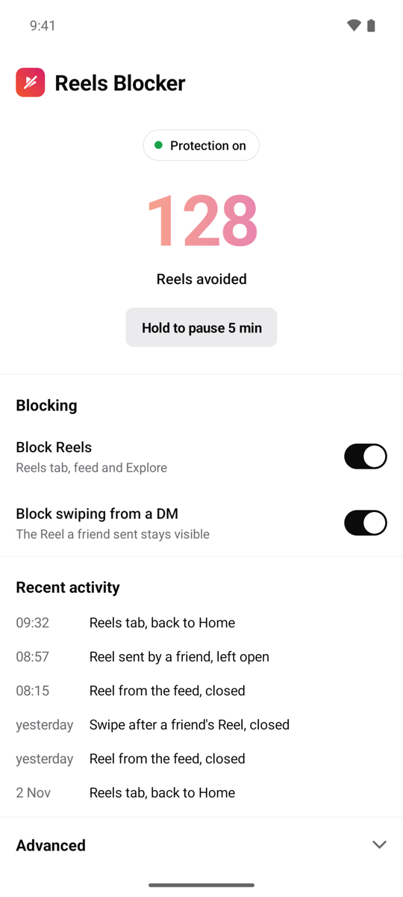
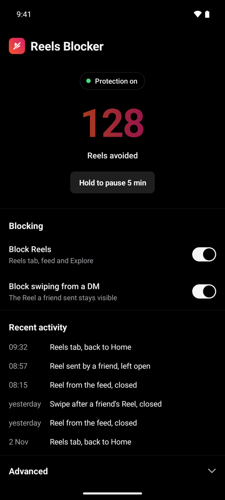

# Reels Blocker

[Read in English](README.md)

Une petite app Android qui bloque les Reels d'Instagram **sans bloquer Instagram**.
Les messages, les stories et les Reels qu'un ami t'envoie en DM restent accessibles. Le fil infini de Reels, lui, n'est plus atteignable.

<p>
  
  
</p>

## Ce que ça fait

| Tu ouvres… | Reels Blocker… |
|---|---|
| l'onglet Reels | te ramène sur l'onglet Accueil |
| un Reel en plein écran depuis le fil, Explorer ou un profil | le ferme (un seul retour arrière) |
| un Reel envoyé par un ami en DM | le laisse ouvert |
| le Reel suivant en swipant depuis ce DM | le ferme (désactivable) |

Un compteur montre combien de Reels tu as évités, et le journal liste les dernières décisions.

## Pourquoi

- **Rien ne quitte ton téléphone** : pas de permission Internet, pas de pub, pas de tracker.
- **Minuscule** : aucune dépendance, APK de moins de 200 Ko.
- **Open source** : le service qui lit Instagram tient en ~300 lignes, lisibles d'un trait.

## Installer

1. Télécharge l'APK depuis les [Releases](../../releases), ou compile-le (voir plus bas).
2. Ouvre-le sur ton téléphone. Si Play Protect bloque : **Plus de détails → Installer quand même**.
3. Dans l'app, appuie sur **Ouvrir** à côté de *Accessibilité*, puis active « Reels Blocker ».
   - Si le réglage est grisé (« paramètre restreint ») : *Réglages → Applications → Reels Blocker → ⋮ → Autoriser les paramètres restreints*.
4. **Xiaomi / HyperOS** : active le démarrage automatique et mets la batterie sur « Aucune restriction », sinon le système coupe le service.

## Comment ça marche

Un [AccessibilityService](https://developer.android.com/guide/topics/ui/accessibility/service) lit les identifiants des vues d'Instagram (rien d'autre : pas de texte, pas d'image).
L'app regarde **ce qui est réellement au premier plan** (au centre de l'écran et au niveau de la barre d'onglets), car Instagram garde les onglets déjà visités cachés derrière l'écran courant.
L'origine d'un Reel (DM ou fil) est mémorisée jusqu'au retour sur un écran principal, et un coupe-circuit met l'app en pause si elle agit trop souvent d'affilée.

Si une mise à jour d'Instagram casse la détection : *Avancé → Mode diagnostic*, reproduis le cas, puis *Copier le relevé*. Les identifiants à ajuster sont en bas de `ReelsBlockerService.kt`.

## Compiler

Il faut le JDK 17 et le SDK Android (Android Studio n'est pas nécessaire).

```sh
./build.sh            # produit app/build/outputs/apk/release/app-release.apk
./build.sh --install  # l'installe sur le téléphone branché en USB
```

`build.sh` lit `JAVA_HOME` et `ANDROID_HOME` dans l'environnement, et trouve tout seul une installation Homebrew sur macOS.

## Licence

Code sous licence MIT. Police [Outfit](https://github.com/Outfitio/Outfit-Fonts) sous licence SIL OFL 1.1.
Projet indépendant, sans lien avec Instagram ou Meta.
