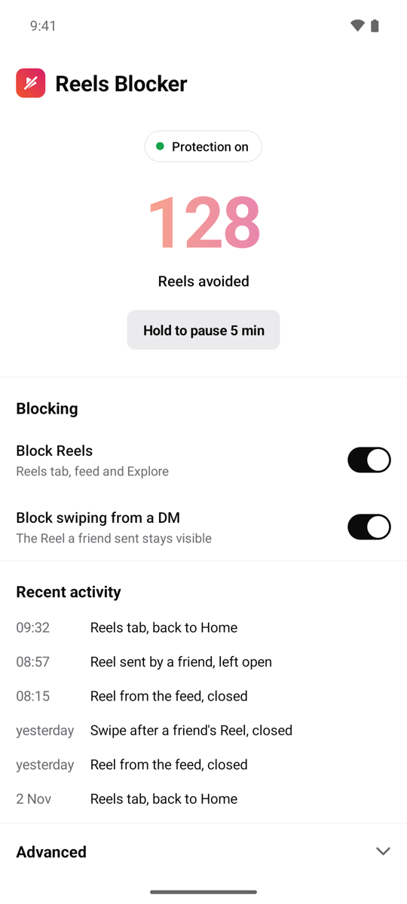
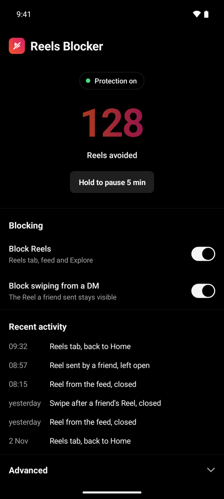

# Reels Blocker

**Block Instagram Reels without blocking Instagram.**

Reels Blocker is a tiny, open-source Android app that cuts off the endless Reels feed while keeping everything else in Instagram working: your messages, stories, and the Reels friends send you in DMs.

[](https://github.com/Gradrien/reels-blocker/actions/workflows/build.yml)
[](LICENSE)


<p>
  
  
</p>

[Lire en français](README.fr.md)

## What it does

| When you open… | Reels Blocker… |
|---|---|
| the Reels tab | switches you back to the Home tab |
| a fullscreen Reel from the feed, Explore or a profile | closes it (a single Back) |
| a Reel a friend sent you in a DM | leaves it open |
| the next Reel by swiping from that DM | closes it (can be turned off) |

A counter shows how many Reels you avoided, and a short log lists the latest decisions.

## Why this one

- **Nothing leaves your phone.** No internet permission, no ads, no analytics, no account.
- **Tiny.** No third-party dependencies; the APK is well under 200 KB.
- **Readable.** The part that watches Instagram is about 300 lines of Kotlin you can read in one sitting.
- **Friends first.** Reels shared with you are not the problem; the infinite feed is.

## Install

1. Download the latest APK from [Releases](https://github.com/Gradrien/reels-blocker/releases), or [build it yourself](#build-from-source).
2. Open it on your phone. If Play Protect warns you, tap **More details → Install anyway**.
3. In the app, tap **Open** next to *Accessibility* and turn on “Reels Blocker”.
   - If the switch is greyed out (“Restricted setting”): *Settings → Apps → Reels Blocker → ⋮ → Allow restricted settings*, then try again.
4. **Xiaomi / HyperOS / MIUI:** turn on *Autostart* and set *Battery saver* to “No restrictions”, otherwise the system stops the service.

The app UI is available in English and French and follows your phone's language.

## How it works

Reels Blocker is an Android [AccessibilityService](https://developer.android.com/guide/topics/ui/accessibility/service). It reads Instagram's **view ids only** (for example `clips_viewer_view_pager`), never the text, images or videos on screen.

- It looks at **what is actually on top** at the center of the screen and at the tab bar, because Instagram keeps previously visited tabs alive behind the current one.
- When a Reel opens, it remembers where you came from (a DM or a main tab) until you go back to one of those screens.
- To close a Reel it performs a single Back; on the Reels tab it taps Home instead, so it can never close Instagram itself.
- A circuit breaker pauses the app for a minute if it acts too often in a row, so a detection bug cannot trap you in a loop.

### Privacy

The app has no `INTERNET` permission, so it physically cannot send anything. Settings, the counter and the log are stored in the app's private storage and are not included in Android backups. The optional diagnostic report stays on the phone until you copy it yourself.

## When Instagram updates break detection

Instagram renames its internal view ids from time to time. To help fix it:

1. In the app, open **Advanced → Diagnostic mode**.
2. Reproduce the problem in Instagram, come back, tap **Copy report**.
3. [Open an issue](https://github.com/Gradrien/reels-blocker/issues/new/choose) with the report.

The ids to adjust live at the bottom of [`ReelsBlockerService.kt`](app/src/main/java/fr/adrien/reelsblocker/ReelsBlockerService.kt).

## Build from source

You need JDK 17 and the Android SDK (Android Studio is optional).

```sh
./build.sh            # builds app/build/outputs/apk/release/app-release.apk
./build.sh --install  # also installs it on the phone connected over USB
```

`build.sh` uses `JAVA_HOME` and `ANDROID_HOME` from your environment, and finds Homebrew installs on macOS automatically. Without a release key (see [CONTRIBUTING.md](CONTRIBUTING.md#release-signing)) the release APK is signed with your debug key, which is fine for personal use.

## FAQ

**Why does it need Accessibility access?**
It is the only Android API that lets an app see which screen another app is showing and press Back for you. Reels Blocker uses it for Instagram only and ignores every other app.

**Does it work with Instagram Lite, Facebook or YouTube Shorts?**
Not today. Only the main Instagram app (`com.instagram.android`) is supported.

**Is it on the Play Store?**
No. Google restricts Accessibility services that are not assistive tools, so the app is distributed as an APK on GitHub.

## Contributing

Bug reports, detection fixes and translations are very welcome. Start with [CONTRIBUTING.md](CONTRIBUTING.md).

## License

Code under the [MIT License](LICENSE). The [Outfit](https://github.com/Outfitio/Outfit-Fonts) typeface is under the [SIL Open Font License 1.1](licenses/Outfit-OFL.txt).

Reels Blocker is an independent project, not affiliated with, endorsed by or sponsored by Instagram or Meta. Instagram is a trademark of Meta Platforms, Inc.
